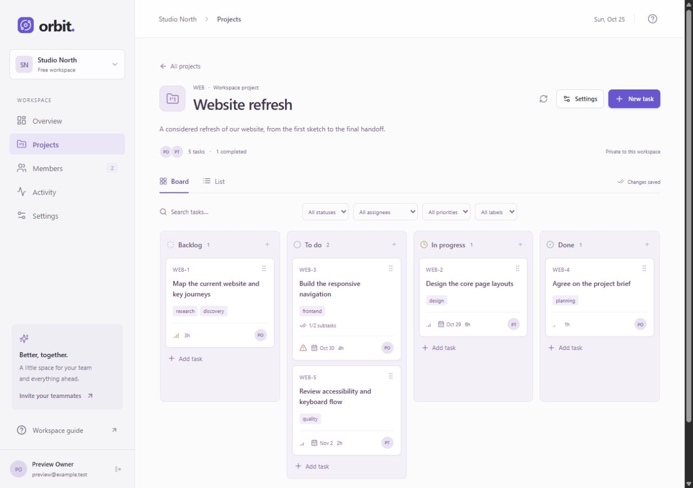
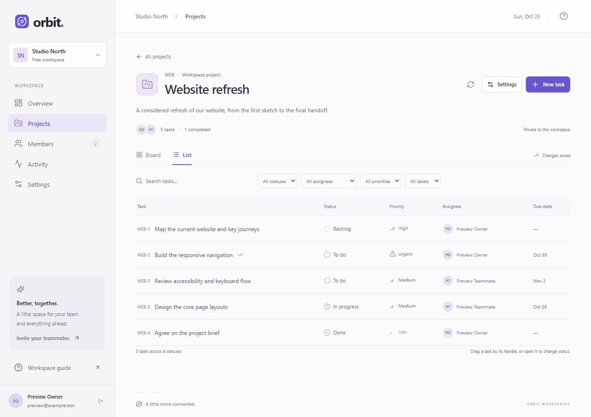
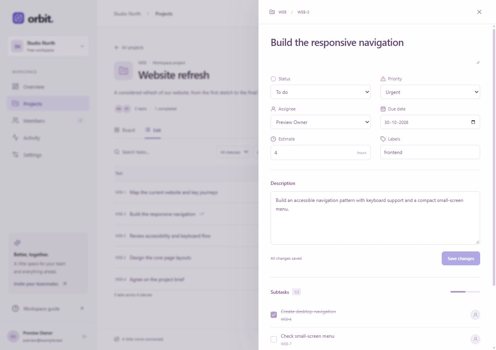

# Phase 2 verification

Verified locally on **25 October 2026**, application version **0.2.0**.

## Completed scope

Projects; project leads and guest sharing; archive/restore and guarded deletion; tasks and stable task numbers; board/list views; task search and filters; assignment, priority, labels, due dates, estimates; one level of subtasks; transactional ordering; task/project revisions; conflict handling; and project-aware activity visibility.

## Automated checks

- `npm test`: **56 passed, 0 failed** — all 29 phase-1 tests plus 27 phase-2 tests.
- `npm run build`: **passed** — strict TypeScript check, frontend build, and backend bundle.
- `npm audit --omit=dev`: **0 known vulnerabilities** at verification time.

The work tests run against an isolated temporary MongoDB replica set. They cover project key uniqueness per workspace, foreign tenant/project IDs, guest grants and hidden private activity, role restrictions, assignee/lead validation, property validation, task/project revisions, real concurrent board moves, stale writes, ordering, rollback on invalid drop targets, completion timestamps, subtasks, deletion permissions and cascades, monotonic task numbering, archived state, history, validated filtered task reads, and unscoped model queries.

## Browser checks

- Created `Website refresh` (`WEB`) inside the existing local `Studio North` review workspace through the UI.
- Created five top-level tasks across all four statuses, with real assignments, priorities, labels, estimates, and due dates.
- Verified date changes reached the saved task and remained visible on board/list views. Corrected the native date field's input event handling during QA.
- Added two subtasks to WEB-3 and completed one. The panel and card both show 1/2 completed; project task counts remain five.
- Tested unsaved-edit protection when closing a task, kept the draft, and saved it.
- Verified status, assignee, priority, and label filters against their expected task sets, plus text search matching a task description.
- Switched between board and list views and confirmed saved properties and dates.
- Used pointer dragging to move WEB-3 between columns.
- Used keyboard movement between columns, and up/down reordering within a column. Refreshed from the server and confirmed saved order. Corrected cross-column keyboard targeting during QA; announcements now use task codes/titles rather than database IDs.
- Opened two views of WEB-3 in the same browser. Kept an unsaved draft in one view, saved a newer priority in the other, and confirmed that saving the stale view returned a conflict while preserving its draft. Explicit reload then showed the newer priority and saved description.
- Archived the project, confirmed creation controls disappeared and the UI became read-only, and restored it to active.
- Restarted the app and local database. The existing session, project, tasks, task order, dates, labels, estimates, and subtask completion remained available.
- Switched to `Field Notes` and confirmed its project list remained empty. Switched back to `Studio North` and reopened the saved board.

These screenshots are actual local application captures using review data created through the UI:

## Limits and next phase

- Local development only; no cloud deployment or publishing occurred.
- Browser QA used a desktop viewport. Responsive styles are implemented; physical-phone QA remains pending.
- The two-view conflict check used two tabs in the same browser session. It does not establish live two-device synchronization.
- Board snapshots are refreshed manually. Socket.io synchronization, comments, email delivery, mentions, notifications, and attachments belong to phase 3. Sprints and reporting remain later work.
- Guest visibility and destructive deletion paths were verified through isolated API tests; the desktop UI pass did not create a guest account or permanently delete the retained review project.
- No large-board load test or comprehensive production security audit was performed.

The phase-1 verification record and source archive remain available separately.
